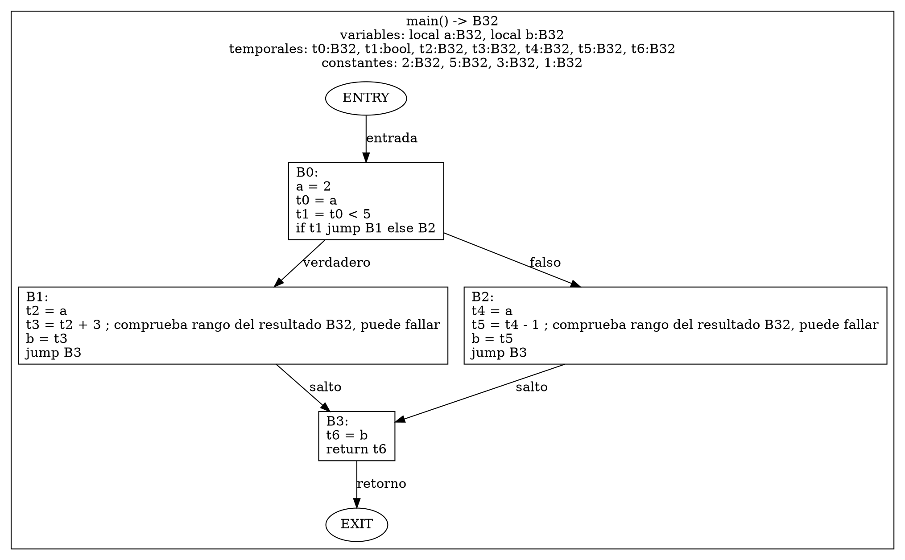

# Ejemplo completo: fuente → análisis → IR → CFG

El fuente de este documento se comprobó con el frontend actual: `--check` aprobó y `ins -t` produjo AST y símbolos. Las salidas `.ir` y `.dot` son **resultados esperados del contrato**, no archivos producidos por los módulos actuales. I1–I5 ya cubren almacenamiento, enlaces semánticos, TAC escalar, rutinas, llamadas, retornos y control de forma interna. Validación, publicación y exportación siguen pendientes. No se aplican optimizaciones.

Los comentarios `comprueba rango del resultado B32, puede fallar` verifican que el resultado de esa operación quepa en B32 (−2147483648 a 2147483647). Desbordar ese rango es una posibilidad del tipo de dato, no un defecto del compilador; la comprobación conserva la política de error de Piper. En estos ejemplos los valores sí caben y no se espera ningún fallo. El tipo comprobado es el resultado de la operación, no necesariamente el de una variable que lo reciba después.

## 1. Entrada al compilador

Contenido de `ejemplo.rwt`:

```text
routine B32 main[] {
    create B32 a.
    create B32 b.
    a store 2.
    when [a < 5] {
        b store a + 3.
    } fallback {
        b store a - 1.
    }
    output b.
}
```

El resultado de una futura ejecución correcta es 5: se toma la rama `2 < 5`, que asigna `2 + 3` a `b`. La generación de IR conserva ambas ramas; no ejecuta el programa ni propaga `a = 2` para eliminar una de ellas.

| Comando | Estado / salida |
| --- | --- |
| `bin/pipoc --check ejemplo.rwt` | Disponible: comprueba léxico, sintaxis y semántica; termina con estado 0 y sin archivos. |
| `bin/pipoc ins ejemplo.rwt -t` | Disponible: imprime AST y genera `ejemplo.ast.json` y `ejemplo.symbols.txt`. |
| `bin/pipoc ir ejemplo.rwt -o ejemplo.ir --emit-cfg ejemplo.dot` | Pendiente: exportará IR y CFG sin llamar a codegen. |

## 2. Resumen antes de IR

| Etapa | Qué ocurre con este fuente | Resultado |
| --- | --- | --- |
| Lexer | Reconoce `routine`, B32, identificadores, números, `when`, `fallback`, operadores y delimitadores. | Sin errores léxicos. |
| Parser Bison | Forma declaración de rutina, declaraciones locales, asignación, condicional y retorno. Respeta la estructura `a + 3` y `a - 1`. | AST válido. |
| Semántico | Registra `main[]`, `a` y `b`; comprueba tipos, uso inicializado de `a`, condición y retorno B32. `b` recibe valor en ambas ramas antes de `output`. | Análisis aprobado y tabla final disponible. |
| Orquestador | Comprueba `yyparse == 0`, AST no nulo y retorno semántico igual a 1. | Puede llamar al futuro `ir_generate` con AST y tabla de esta ejecución. |

No se vuelve a ejecutar el frontend dentro de IR. Semántica ya conserva en `AstNode.resolved_symbol` la referencia al símbolo final por uso; en este ejemplo se denominarán `S_a` y `S_b` solo para explicar esos enlaces, no para imprimirlos en TAC.

## 3. Forma del AST

`ast_print` y `ast_print_json` muestran `resolved_symbol` en cada nodo: nombre, tipo declarado y línea de declaración, o `null` si no hay enlace. El árbol conserva sus mismos nodos e hijos; se imprime un resumen del símbolo, no su dirección ni toda la tabla. La tabla semántica debe seguir viva al imprimir.

Vista resumida del AST obtenido; se omiten ubicaciones y campos vacíos. Es un árbol de nodos, no el TAC ni el formato literal del JSON:

```text
Program
└── RoutineDeclaration: main, retorno B32, parámetros []
    └── Block
        ├── VariableDeclaration: a, B32
        ├── VariableDeclaration: b, B32
        ├── Assignment
        │   ├── target: IdentifierExpression a
        │   └── value: IntegerLiteral 2
        ├── WhenStatement
        │   ├── condition: BinaryExpression less
        │   │   ├── IdentifierExpression a
        │   │   └── IntegerLiteral 5
        │   ├── then_block: Block
        │   │   └── Assignment
        │   │       ├── target: IdentifierExpression b
        │   │       └── value: BinaryExpression add
        │   │           ├── IdentifierExpression a
        │   │           └── IntegerLiteral 3
        │   └── fallback_block: Block
        │       └── Assignment
        │           ├── target: IdentifierExpression b
        │           └── value: BinaryExpression subtract
        │               ├── IdentifierExpression a
        │               └── IntegerLiteral 1
        └── OutputStatement
            └── IdentifierExpression b
```

El AST no contiene solamente elementos de la tabla de símbolos: representa también operaciones, literales y control. En este ejemplo, la tabla tiene declaraciones de `main`, `a` y `b`; los nodos de suma, comparación, asignación, `when`, bloques y retorno no tienen un `Symbol` propio.

Enlaces después del análisis semántico. `S_main`, `S_a` y `S_b` son nombres explicativos para los objetos `Symbol`; los exportadores muestran el resumen de la declaración correspondiente:

| Nodo del ejemplo | `resolved_symbol` |
| --- | --- |
| `RoutineDeclaration main` | `S_main`: símbolo creado al registrar la rutina. |
| `VariableDeclaration a` | `S_a`: símbolo creado al registrar `a`. |
| Todos los `IdentifierExpression a` | El mismo `S_a`, encontrado al resolver cada uso. |
| `VariableDeclaration b` | `S_b`: símbolo creado al registrar `b`. |
| Todos los `IdentifierExpression b` | El mismo `S_b`, encontrado al resolver cada uso. |
| Literales, operaciones, asignaciones, bloques, `when`, `output` y raíz | NULL: no representan una declaración que deba enlazarse. |

Los enlaces son campos adicionales, no hijos nuevos del árbol. Por ejemplo, `Assignment` sigue teniendo un hijo destino y un hijo valor; el identificador destino es el que apunta al símbolo que se escribe. Semántica ya creaba/buscaba esos símbolos para validar el código; I2 conserva el resultado de esa resolución para que IR lo reutilice.

En el identificador `a` de `a store 2`, la impresión de texto incluye:

```text
resolved_symbol: a (tipo B32, declaración en línea 2)
```

El campo correspondiente del JSON es:

```json
"resolved_symbol": {"name": "a", "type": "B32", "declaration_line": 2}
```

Otras anotaciones relevantes que el semántico mantiene en memoria:

| Nodo / dato | Información usada por IR |
| --- | --- |
| Usos de `a` y `b` | Tipo exacto B32; `resolved_symbol` apunta a sus declaraciones finales. |
| `a < 5` | Resultado bool; comparación de enteros B32. |
| `a + 3`, `a - 1` | Resultado B32 y semántica aritmética comprobada. |
| Literales 1, 2, 3 y 5 | Valores constantes; IR concretará B32 a partir de los usos y anotaciones. |
| `main` | Retorno B32, sin parámetros, ámbito de función. |

El tipo de una suma o comparación es una anotación del nodo de expresión; tener tipo no implica tener una entrada propia en la tabla de símbolos.

## 4. Tabla de símbolos final

Resumen de la salida actual de `--emit-symbols`:

| Ámbito | Nombre | Clase | Tipo | Bytes | Ubicación actual |
| --- | --- | --- | --- | --- | --- |
| 0, global | `main` | Función | Retorno B32 | 0 | Etiqueta `main`. |
| 1, rutina `main` | `a` | Variable | B32 | 4 | `r7 + 0x0000`. |
| 1, rutina `main` | `b` | Variable | B32 | 4 | `r7 + 0x0004`. |
| 2, rama verdadera | — | — | — | — | Sin declaraciones propias. |
| 3, rama falsa | — | — | — | — | Sin declaraciones propias. |

Los offsets son datos del compilador actual; IR no los usa como identidad ni reserva pila para temporales. La generación consulta las declaraciones y tipos. `S_a` y `S_b` son referencias prestadas a las variables del ámbito 1, aunque se usen dentro de los ámbitos 2 y 3. Los temporales nuevos no se insertan en esta tabla.

## 5. Recorrido interno del generador

| Paso | Función / estado | Operaciones o resultado |
| --- | --- | --- |
| 1 | `ir_generate(root, symbols, &program, &diagnostic)` | Crea modelo provisional y contexto con `error.status = IR_OK`. Ningún resultado se publica aún. |
| 2 | `ir_build_program(ctx)` | Registra la rutina `main` con su `Symbol` final. No crea arranque sintético porque no hay sentencias globales. |
| 3 | `ir_new_block(ctx)` y selección de B0 | Establece entrada B0; `ir_stmt` recorre el cuerpo. Las declaraciones solo aportan datos ya existentes en la tabla. |
| 4 | `ir_stmt(a store 2)` | `ir_target(a)` devuelve `S_a`; `ir_expr(2)` devuelve constante B32. `ir_emit` agrega `a = 2`. |
| 5 | `ir_stmt(when ...)` → `ir_expr(a < 5)` | Captura `a` en `t0:B32`; crea `t1:bool` con `t0 < 5`. |
| 6 | Crear B1, B2 y B3; emitir condición | Agrega `if t1 jump B1 else B2` a B0 y cierra ese camino. B1 será verdadero, B2 falso y B3 unión. |
| 7 | Seleccionar B1; `ir_stmt(b store a + 3)` | Destino `S_b`; `ir_expr` crea `t2 = a` y `t3 = t2 + 3`. Emite `b = t3` y `jump B3`. |
| 8 | Seleccionar B2; `ir_stmt(b store a - 1)` | Mismo destino `S_b`; crea `t4 = a` y `t5 = t4 - 1`. Emite `b = t5` y `jump B3`. |
| 9 | Seleccionar B3; `ir_stmt(output b)` | Captura `b` en `t6:B32`; emite `return t6` y deja `ctx->current_block = IR_NO_ID`. |
| 10 | `ir_validate(program, diagnostic)` | Comprueba tipos, definición de temporales, cuatro bloques y destinos existentes; cada bloque tiene transferencia final. |
| 11 | Fin de `ir_generate` | Libera recursos del contexto y entrega propiedad del programa al llamador con `IR_OK`. |
| 12 | `ir_write(output, program)` | Recorre ese modelo: escribe cabeceras de tipos, instrucciones y todos los flags activos. No vuelve al AST ni genera otro TAC. |

Dentro de `ir_expr`, los literales se convierten en operandos y los identificadores se capturan antes de emitir la operación padre. Por ejemplo, `a + 3` produce lectura de `a`, constante 3 y finalmente suma. `ir_emit` es el mismo para copia, suma, condición, salto y retorno.

### Ejemplo de una instrucción en memoria

La instrucción de suma de B1 tendrá estos datos:

| Campo | Valor esperado |
| --- | --- |
| `op` | `IR_OP_ADD`. |
| `arg1` | Temporal ID 2, tipo B32, `address = false`. |
| `arg2` | Constante 3, tipo B32, `address = false`. |
| `result` | Temporal ID 3, tipo B32, `address = false`. |
| `flags` | `IR_CHECKED` e `IR_MAY_TRAP`. |
| `location` | Expresión `a + 3`, línea 6, columnas 17–22 según el AST actual. |

Se verá como `t3 = t2 + 3 ; comprueba rango del resultado B32, puede fallar`; su tipo aparece en la cabecera. Las copias escalares locales, comparación y transferencias de este ejemplo no tienen flags activos. No se confunde el resultado bool `t1` con los temporales enteros.

Al terminar: una rutina, cuatro bloques, siete temporales, catorce instrucciones contando los saltos/retorno y ningún destino de `break`. La tabla semántica sigue viva; no se le agregaron los temporales.

## 6. Salida esperada: `ejemplo.ir`

```text
function main() -> B32
    variables: local a:B32, local b:B32
    temporales: t0:B32, t1:bool, t2:B32, t3:B32, t4:B32, t5:B32, t6:B32
    constantes: 2:B32, 5:B32, 3:B32, 1:B32
B0:
    a = 2
    t0 = a
    t1 = t0 < 5
    if t1 jump B1 else B2
B1:
    t2 = a
    t3 = t2 + 3 ; comprueba rango del resultado B32, puede fallar
    b = t3
    jump B3
B2:
    t4 = a
    t5 = t4 - 1 ; comprueba rango del resultado B32, puede fallar
    b = t5
    jump B3
B3:
    t6 = b
    return t6
```

Los temporales/constantes se listan en orden de primera aparición. La cabecera es parte de la exportación de IR, no código Piper. Sin comentario de flags equivale a flags=0. Las variables siguen siendo símbolos reasignables; no se introduce SSA ni una función φ para combinar las asignaciones de `b`.

## 7. Construcción posterior del CFG

| Paso | Entrada → salida |
| --- | --- |
| `cfg_build(program, &cfg, &diagnostic)` | Recibe el mismo `IrProgram`; crea nodos ENTRY, B0–B3 y EXIT para `main`. |
| Consultar últimas instrucciones | B0 aporta dos destinos; B1 y B2 saltan a B3; B3 retorna. No consulta el AST. |
| Calcular adyacencias | Registra las conexiones de la tabla siguiente y sus predecesores. |
| Marcar alcanzables y validar | Los seis nodos son alcanzables estructuralmente. No evalúa la condición constante para quitar B2. |
| `cfg_write_dot(output, cfg)` | Imprime firma/metadatos y las mismas instrucciones como etiquetas, con sus aristas. |

| Origen | Destino | Clase |
| --- | --- | --- |
| ENTRY | B0 | Entrada. |
| B0 | B1 | Verdadero. |
| B0 | B2 | Falso. |
| B1 | B3 | Salto. |
| B2 | B3 | Salto. |
| B3 | EXIT | Retorno. |

## 8. Salida esperada: `ejemplo.dot`

DOT es el archivo de descripción del CFG; un visor podrá dibujarlo. `r0` identifica la rutina 0 y evita colisiones si después se agregan más funciones. La firma y las listas de tipos forman la cabecera del subgrafo; no se convierten en nodos de ejecución.



`\l` separa líneas alineadas a la izquierda dentro de una etiqueta DOT. No forma parte del TAC.

## 9. Entrega a los consumidores

| Consumidor | Qué recibe de este ejemplo |
| --- | --- |
| Optimizador futuro | Programa con cuatro bloques, operaciones tipadas, efectos y CFG de seis conexiones. Podrá analizar/reducirlo en una etapa posterior. |
| Codegen futuro | IR optimizada y declaraciones referenciadas; distinguirá B32/bool por los operandos y podrá consultar símbolos. El CFG no sustituye las instrucciones. |
| Lector humano | `.ir` con tipos/efectos y `.dot` con conexiones; ambos describen el mismo modelo. |

Liberación posterior: CFG → IR → AST → tabla de símbolos. El ejemplo documenta el flujo y no agrega implementación ni una prueba automatizada nueva.

## 10. Estructuras de control para I5

Las fuentes de esta sección son ejemplos completos de una sola rutina; sus análisis previos se pueden comprobar con `--check`. El TAC es **el cuerpo esquemático**: se omiten las cabeceras de variables/temporales/constantes para mostrar las conexiones. Un archivo `.ir` completo sí incluirá esas cabeceras, como en la sección 6. Cada ejemplo comienza sus propios IDs B0/t0.

### Reglas y restricciones iniciales

| Construcción | Entrada / restricciones | Estructura y regla de traducción |
| --- | --- | --- |
| `when [condición]` | Condición bool o entera aprobada por semántica. Una condición entera se compara con cero. `fallback` es opcional. | Evaluar una vez al llegar. Emitir dos destinos; sin fallback, el falso es la continuación. Cada rama que continúa salta a la unión. Si ambas retornan, no crear continuación ejecutable. |
| `alwhen [condición]` | Condición bool o entera; puede ejecutarse cero veces. | Entrada → condición → cuerpo o salida. Cada vuelta regresa a condición y vuelve a evaluar sus lecturas/llamadas. No convertir una condición dinámica en un valor calculado una sola vez. |
| `loop [i & inicio -> fin & paso]` | Control entero declarado. Inicio/fin enteros aprobados. En esta primera versión, paso es un literal entero positivo: no cero, negativo ni expresión general. | Asignar inicio una vez. Reevaluar fin antes de comparar en cada vuelta. Ejecutar mientras control < fin; fin es exclusivo. Tras el cuerpo, avanzar control y volver a condición. |
| `break` | Debe estar dentro de un ciclo de la misma rutina; una condición por sí sola no habilita break. | Saltar a la salida del ciclo más interno. Omitir el resto de ese camino, incluido el avance del loop. No salir accidentalmente de todos los ciclos anidados. |
| `output` dentro de cualquiera | Retorno compatible con la firma, ya comprobado. | Emitir return y no agregar luego otro salto al mismo bloque. |

Las restricciones del paso de `loop` reflejan la compatibilidad inicial con el codegen actual: parser/semántica aceptan más formas, pero la IR no debe traducirlas incorrectamente; informará `IR_UNSUPPORTED` mientras no se defina su soporte. `++`/`--` siguen siendo prefijos y se limitan inicialmente a identificadores escalares, conforme al contrato.

### 10.1. `when` con y sin `fallback`

El ejemplo principal de las secciones 1–8 ya muestra `when` con dos ramas y unión. Sin fallback, el camino falso va directamente a la continuación:

```piper
routine B32 main[] {
    create B32 a.
    create B32 b.
    a store 2.
    b store 0.
    when [a < 5] { b store a + 1. }
    output b.
}
```

```text
B0:
    a = 2
    b = 0
    t0 = a
    t1 = t0 < 5
    if t1 jump B1 else B2
B1:
    t2 = a
    t3 = t2 + 1 ; comprueba rango del resultado B32, puede fallar
    b = t3
    jump B2
B2:
    t4 = b
    return t4
```

No se crea un bloque falso vacío: B2 es la continuación. `b` se inicializa antes de la condición porque la rama verdadera podría no ejecutarse. Resultado esperado: 3.

### 10.2. `alwhen`: condición reevaluada

```piper
routine B32 main[] {
    create B32 i.
    i store 0.
    alwhen [i < 3] { i store i + 1. }
    output i.
}
```

```text
B0:
    i = 0
    jump B1
B1:
    t0 = i
    t1 = t0 < 3
    if t1 jump B2 else B3
B2:
    t2 = i
    t3 = t2 + 1 ; comprueba rango del resultado B32, puede fallar
    i = t3
    jump B1
B3:
    t4 = i
    return t4
```

`jump B1` vuelve a ejecutar la lectura de `i` y la comparación. t0/t1 son las mismas instrucciones del ciclo y se ejecutan cada vuelta; no se generan temporales nuevos por iteración en tiempo de ejecución. Resultado esperado: 3.

### 10.3. `loop`: inicio, condición, cuerpo, avance y salida

```piper
routine B32 main[] {
    create B32 i.
    create B32 suma.
    suma store 0.
    loop [i & 0 -> 3 & 1] {
        suma store suma + i.
    }
    output suma.
}
```

```text
B0:
    suma = 0
    i = 0
    jump B1
B1:
    t0 = i
    t1 = t0 < 3
    if t1 jump B2 else B3
B2:
    t2 = suma
    t3 = i
    t4 = t2 + t3 ; comprueba rango del resultado B32, puede fallar
    suma = t4
    jump B4
B3:
    t7 = suma
    return t7
B4:
    t5 = i
    t6 = t5 + 1
    i = t6
    jump B1
```

El inicio solo se asigna en B0. Aquí el fin es el literal 3, por lo que su evaluación no emite instrucciones; si fuese una expresión, sus instrucciones irían dentro de B1 y se ejecutarían cada vuelta. El cuerpo usa i=0, 1 y 2; resultado esperado: 3.

La salida B3 se reserva antes del avance B4; este último solo se crea si el cuerpo continúa. El avance B4 conserva el comportamiento actual del incremento del control de `loop`, sin agregar una nueva comprobación de rango. No se confunde con una expresión prefija `++i`, que tiene sus propias comprobaciones. No se realiza unrolling en esta etapa.

### 10.4. `break`: salida del ciclo desde un `when`

```piper
routine B32 main[] {
    create B32 i.
    i store 0.
    alwhen [i < 5] {
        when [i = 2] { break. }
        i store i + 1.
    }
    output i.
}
```

```text
B0:
    i = 0
    jump B1
B1:
    t0 = i
    t1 = t0 < 5
    if t1 jump B2 else B3
B2:
    t2 = i
    t3 = t2 == 2
    if t3 jump B4 else B5
B3:
    t6 = i
    return t6
B4:
    jump B3
B5:
    t4 = i
    t5 = t4 + 1 ; comprueba rango del resultado B32, puede fallar
    i = t5
    jump B1
```

Al entrar al ciclo se apila B3. El `when` no apila otra salida de ciclo: `break` consulta B3 y emite el salto de B4. Así evita el incremento de B5 y retorna 2. Los números de etiqueta no indican ejecución consecutiva; la transferencia explícita determina el camino.

En ciclos anidados, cada ciclo apila su propia salida. El `break` usa el último destino; al terminar de traducir ese ciclo, se retira su entrada y vuelve a quedar visible la salida del ciclo exterior.

Estos ejemplos describen el TAC de I5 comprobado de forma aislada; no añaden pruebas permanentes ni habilitan todavía archivos .ir. La salida CFG sigue pendiente de su módulo.
